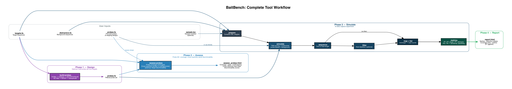

# Pipeline Overview

BaitBench models a hybridization capture experiment as a sequence of discrete computational steps, each producing an intermediate file that is passed to the next. This page explains what each step does and why it exists.

---

## The whole tool at a glance

BaitBench spans four phases. Probe **design** (`build-probes`) and **assessment** (`assess-probes`) are optional and independent of the simulation — bring your own probes and you start at the simulate phase.

[](../diagrams/paper_workflow_overview.png)

*The four phases and how user inputs flow through them. Dashed arrows are optional paths. Click to enlarge.*

The rest of this page covers Phase 3 (simulate) in detail. For Phases 1 and 2, see [Design and Assess Probes](../how-to/design-and-assess-probes.md).

---

## Standard mode pipeline

```
targets.fa + distractors.fa + probes.fa [+ sample.tsv]
         │
    prepare     ← combine references, assign weights
         │
    simulate    ← probe-biased fragment sampling (TNN scoring)
         │
    sequence    ← trim fragments to read length
         │
    filter      ← optional host filtering
         │
    map         ← align reads back to combined_reference.fa
         │
    list        ← count reads per reference
         │
    metrics     ← 3-way TP/FP/FN/TN classification
         │
    report      ← HTML with ggplot2 figures
```

---

## The 8-Step Pipeline

### 1. prepare

**Input:** targets.fa, distractors.fa, optional sample.tsv  
**Output:** combined_reference.fa, weights.tsv, sample.txt

Merges all sequences (targets + distractors) into a single reference file with unique IDs and a prefix encoding their role. Computes the weight for each sequence — the probability that a randomly drawn fragment comes from that sequence. Sample targets get weights from the manifest (default 1.0); non-sample targets get weight 0; distractor weight is derived from the `--distractor-fraction` or `--ct` parameter.

Setting non-sample target weights to 0 is the key design choice: BaitBench generates no fragments from those targets, so any reads mapping to them in the final output can only arise from cross-mapping or probe cross-reactivity — a reliable false-positive signal.

### 2. simulate

**Input:** combined_reference.fa, probes.fa, weights.tsv  
**Output:** fragments.fa

The core step. Probes are aligned to the reference, each alignment is turned into a binding probability, and fragments are drawn in proportion to how likely they are to survive the capture.

Probes are placed by the built-in seed-and-extend aligner (or minimap2/blast, via `--probe-aligner`). In thermodynamic mode (the default), each alignment is scored with the SantaLucia nearest-neighbor model to compute ΔG, which becomes an occupancy `θ = K/(1+K)` under the Langmuir isotherm. Every fragment then has a single retention probability

```
p_retain = 1 − (1 − p_ns) · Π (1 − θ_i)
```

over the probes overlapping it, where `p_ns` is non-specific carryover (`--background-retention`). A fragment covered by no probe reduces to `p_ns`; one covered by several gets each probe's independent chance, so probe density compounds.

There is no quota: `--capture-fraction` sets how efficiently the panel pulls down material it has probes for, and the **composition of the output emerges** from abundance × efficiency. That is what lets a dilution series titrate and keeps `--distractor-fraction` meaningful across its whole range. The realized yield, on-target fraction and enrichment are computed analytically and written to `fragments.model_stats.tsv`, with per-reference efficiency in `fragments.retention.tsv`.

Simple mode (`--simulate-mode simple`) gives every placed probe the same occupancy, dropping temperature and sequence composition but keeping probe density — a useful null model.

### 3. sequence

**Input:** fragments.fa  
**Output:** reads.fa (or reads.fq)

Simulates the sequencing step. By default, fragments are trimmed to `--read-length` bases; in paired-end mode two reads are trimmed from each end. Optionally, ART or Badread can be used to simulate real sequencing error profiles.

### 4. filter (optional)

**Input:** reads.fa  
**Output:** filtered_reads.fa

If `--filter-genomes` is provided (e.g., a host genome), reads that align to the filter genome are removed. This simulates a host-depletion step before pathogen detection.

### 5. map

**Input:** reads.fa, combined_reference.fa  
**Output:** mappings.sam

Maps reads back to the combined reference. The SAM RNAME field records which reference each read mapped to. This determines both detection (which sequences generated reads) and accuracy (did reads map back to their source?).

### 6. list

**Input:** mappings.sam  
**Output:** read_counts.tsv

Parses the SAM file to count reads per reference. A reference is "detected" if its read count is ≥ 1.

### 7. metrics

**Input:** read_counts.tsv, reference metadata  
**Output:** results.tsv, results.json, detected_detail.tsv, group_detail.tsv, coverage.tsv

Computes the 3-way classification (TP / FP_target / FP_distractor / FN / TN_target / TN_distractor) at the genome or group level. Writes per-sequence coverage statistics (average depth, breadth at 5× and 20×) for every detected reference.

### 8. report

**Input:** results.tsv, coverage.tsv, detected_detail.tsv  
**Output:** report.html

Invokes Rscript to render the RMarkdown template with ggplot2 visualizations. Optional; skip with `--report none`.

---

## Genome Mode Data Flow

Genome mode adds a distinction between **source sequences** (where fragments come from) and **mapping targets** (where reads are aligned back to). This is necessary for bacteria and other large pathogens where probes target a specific gene (e.g., 16S rRNA) but the sample contains the full genome.

```
genomes.fa + targets.fa + distractors.fa [+ sample.tsv] [+ mapping.tsv]
         │
    prepare     ← two reference files:
         │         combined_reference.fa  (genomes + distractors) — fragment source
         │         mapping_reference.fa   (targets + distractors) — mapping target
         │
    simulate    ← probe-biased fragments from combined_reference.fa
         │
    sequence    ← trim fragments to read length
         │
    filter      ← optional host filtering
         │
    map         ← align reads back to mapping_reference.fa
         │
    list, metrics, report ← genome-aware classification via sample-target-map
```

Fragments come from **genomes** (full sequences including non-target regions), but reads are mapped to **targets** (gene sequences the probes were designed against). A read from *M. tuberculosis* chromosome only maps successfully if it happens to span the 16S rRNA region present in `targets.fa`. This models the real biology: probes designed against a 16S gene will capture 16S-containing fragments from the full-genome DNA library.

---

## Intermediate Files

| File | Step written | Contents |
|------|-------------|----------|
| `combined_reference.fa` | prepare | All sequences with role-prefixed IDs |
| `mapping_reference.fa` | prepare (genome mode only) | Targets + distractors — the mapping reference |
| `weights.tsv` | prepare | Per-sequence sampling weights |
| `sample.txt` | prepare | IDs of sample sequences |
| `fragments.fa` | simulate | Captured DNA fragments with source provenance in IDs |
| `reads.fa` / `reads.fq` | sequence | Sequenced reads (trimmed fragments) |
| `filtered_reads.fa` | filter | Reads after host removal |
| `mappings.sam` | map | SAM alignment file |
| `read_counts.tsv` | list | Per-reference read counts |
| `results.tsv` | metrics | All classification metrics, one row |
| `detected_detail.tsv` | metrics | Per-sequence coverage statistics |
| `group_detail.tsv` | metrics | Per-group classification (TP/FP/FN/TN) |
| `coverage.tsv` | metrics | Run-length encoded per-position depth |

`--cleanup` removes all intermediates after the run, keeping only the results and report inputs.

---

## `baitbench run` vs Individual Subcommands

`baitbench run` is the orchestrator — it calls each subcommand in sequence and passes outputs as inputs. You can also run each step individually for debugging or to reuse expensive intermediates:

```bash
# Run just the prepare step, inspect the weights
baitbench prepare --targets targets.fa --distractors distractors.fa \
  --probes probes.fa --distractor-fraction 0.9 --outdir debug_run

cat debug_run/run_*/weights.tsv

# Then run simulate with a different seed without re-running prepare
baitbench simulate --outdir debug_run --seed 99
```

This is useful when iterating on parameters that only affect one step — for example, testing many random seeds without rerunning alignment.
