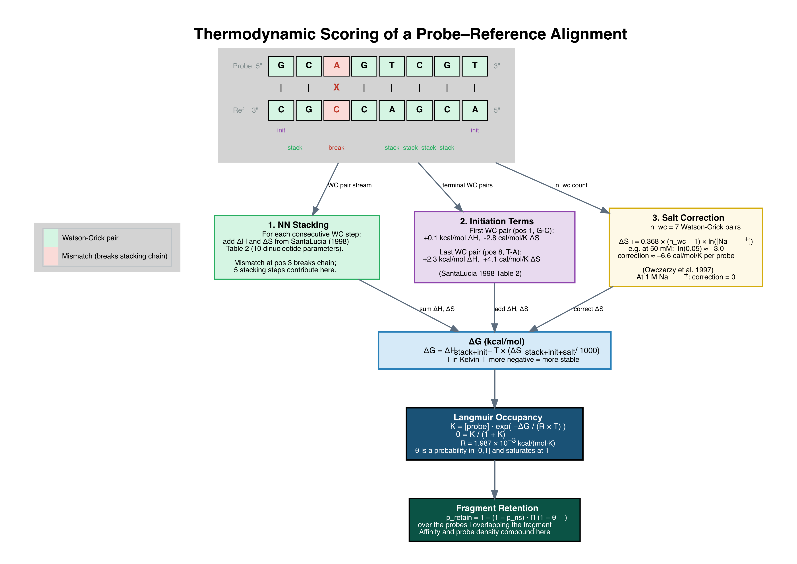

# Thermodynamic Scoring

BaitBench's thermodynamic simulation mode uses the SantaLucia (1998) nearest-neighbor (NN) model to compute the stability of each probe-target duplex, then converts that stability into a per-fragment capture probability. This page explains the model and how it translates to capture efficiency predictions.

---

## Why Thermodynamics?

A probe captures its target if the probe-target duplex is stable enough under the hybridization conditions. Stability is determined by:

1. **Sequence composition**: GC base pairs form three hydrogen bonds (stronger) vs AT/AU two bonds (weaker)
2. **Context effects**: the stability of each base pair depends on its neighbours (nearest-neighbor effects)
3. **Temperature**: higher temperature destabilises duplexes; mismatches are more disruptive at high temperature
4. **Salt concentration**: Na⁺ ions screen the negative phosphate backbone charges, stabilising duplexes

A simple GC-content model misses all the context effects. The SantaLucia (1998) model captures them by summing stacking energies for each adjacent base-pair step — the dominant contribution to duplex stability.

---

## The SantaLucia Nearest-Neighbor Model

The nearest-neighbor model expresses ΔG of duplex formation as:

```
ΔG°(T) = ΔH° - T × ΔS°
```

Where ΔH° and ΔS° are the enthalpy and entropy of hybridization, each computed by summing over all adjacent dinucleotide steps in the sequence:

```
ΔH° = Σ ΔH°(stacking) + ΔH°(initiation)
ΔS° = Σ ΔS°(stacking) + ΔS°(initiation)
```

SantaLucia (1998) provides a unified table of 10 unique nearest-neighbor parameters (the 16 possible dinucleotide steps reduce to 10 by symmetry). BaitBench uses these published values directly.

---

## Computing ΔG: Three Contributions

A worked example, from an aligned probe-reference pair through to the sampling weight it produces:

[](../diagrams/paper_thermodynamic_scoring.png)

*One mismatch at position 3 breaks the stacking chain, so only 5 of the 7 possible stacking steps contribute. Click to enlarge.*

### 1. Stacking terms

For each consecutive base-pair dinucleotide in the probe-target alignment (5'→3'), BaitBench looks up the stacking ΔH° and ΔS° from the SantaLucia (1998) table. Mismatched positions contribute zero stacking energy (they break the consecutive run).

This means a probe with 3 mismatches in a run of otherwise matched positions loses the stacking contributions of all bases adjacent to those mismatches, not just the mismatches themselves. Clustered mismatches are disproportionately destabilising.

### 2. Initiation terms

Two initiation penalties are added, one for the **first** Watson-Crick pair of the aligned duplex and one for the **last**. SantaLucia (1998) gives separate AT and GC initiation parameters, and BaitBench applies whichever matches each terminal pair.

Initiation is only charged when at least one stacking step exists. An isolated Watson-Crick pair flanked by mismatches cannot form a stable duplex, so paying its initiation cost would produce ΔG > 0 — implying the probe is actively repelled, which is unphysical.

### 3. Salt correction (Owczarzy et al. 1997)

The SantaLucia parameters are derived at 1 M Na⁺. For realistic hybridization buffers, BaitBench corrects the **entropy** term for the actual Na⁺ concentration:

```
ΔS([Na⁺]) = ΔS(1 M) + 0.368 × (n_wc - 1) × ln([Na⁺])
```

Where `n_wc` is the number of Watson-Crick paired positions and `[Na⁺]` is molar. At 1 M, `ln(1) = 0` and no correction applies. At lower salt the correction is negative, making ΔG less favourable — matching the physical fact that duplexes are less stable when there are fewer cations to screen the phosphate backbone. As with initiation, the correction is skipped when there is no stacking.

The three contributions are then combined at the hybridization temperature:

```
ΔG = ΔH°(stacking + initiation) - T × ΔS°(stacking + initiation + salt) / 1000
```

With T in Kelvin, ΔH° in kcal/mol, ΔS° in cal/(mol·K), and ΔG in kcal/mol. More negative = more stable.

---

## From ΔG to Occupancy

ΔG says how stable a duplex is; capture needs a *probability*. BaitBench converts one
to the other with the Langmuir isotherm for reversible binding, P + T ⇌ PT:

```
K     = [probe] · exp(-ΔG / (R × T))
theta = K / (1 + K)
```

Where:
- R = 1.987 × 10⁻³ kcal/(mol·K) (gas constant)
- T = hybridization temperature in Kelvin
- ΔG is in kcal/mol
- `[probe]` is the probe concentration, in the arbitrary units absorbed into K

`theta` is the **occupancy**: the probability that this probe is bound to this site at
equilibrium. Three properties matter, none of which a raw Boltzmann weight
`exp(-ΔG/RT)` has:

* **It is bounded in [0, 1]**, so it can be used directly as a probability. The raw
  weight is unbounded — a perfect 120-mer at 65 °C gives ΔG ≈ −92 kcal/mol and
  `exp(-ΔG/RT)` ≈ 1e59, which works as a relative weight within one probe's hit list
  but cannot be a capture probability.
* **It saturates.** A strong binder approaches `theta` = 1 and goes no further, so
  capture cannot be manufactured for an organism that has little template present.
* **It is concentration-dependent**, which is the knob `--capture-fraction` back-solves.

In the weak-binding limit (K ≪ 1), `theta` ≈ K ∝ `exp(-ΔG/RT)`, so this generalises
Boltzmann weighting rather than discarding it.

Occupancy is evaluated as a logistic in log space, `theta = 1/(1 + exp(-ln K))`,
because K itself overflows a 64-bit float for a well-matched probe.

> **Earlier versions** used `exp(-ΔG/RT)` clamped to a minimum of 1.0, on the reasoning
> that probes can enrich fragments but never deplete them. Occupancy needs no such
> clamp: it is a probability by construction, and an unfavourable ΔG simply puts
> `theta` near zero, so a bad probe contributes almost nothing instead of looking
> neutral.

---

## From Occupancy to Fragment Sampling

There are no longer two routes into `fragments.fa`. Every fragment in the library has a
single retention probability:

```
p_retain(f) = 1 - (1 - p_ns) · prod_i (1 - theta_i)
```

over the probes `i` whose alignments overlap fragment `f`, where `p_ns` is non-specific
carryover (`--background-retention`).

Read directly: a fragment escapes capture only if *every* overlapping probe fails to
bind it **and** it is not carried over. A fragment overlapping no probe reduces to
`p_ns`. A fragment overlapping several gets carryover plus each probe's independent
chance, so **probe density compounds**: twenty probes at `theta` = 0.2 retain a
fragment 99% of the time, two retain it 36% of the time.

Affinity and probe density now act on the same quantity, which they did not before.
There is no stage at which a probe is chosen uniformly, so a strong probe really does
capture more than a weak one.

### Why this makes composition emerge

`p_retain` is a property of a fragment, not of the library. So the expected number of
fragments retained from a reference is `abundance × retention`, and the output's
composition follows from the input's rather than being imposed on it. Two consequences
the previous model could not produce:

* **A dilution series titrates.** Halving an organism's abundance halves its reads,
  because retention is unchanged by what else is in the tube.
* **Per-locus efficiency is separable from abundance**, which is what real capture data
  shows: relative capture between loci of the same organism stays roughly constant
  across a dilution series spanning orders of magnitude, while absolute yield tracks
  input.

### Sampling without rejection

Drawing fragments by accept/reject would be hopeless at realistic enrichments: in a
library that is 99.996% off-target at `p_ns` ≈ 1e-3, roughly a thousand candidates are
discarded per keeper.

Instead, note that `p_retain` is **piecewise constant in position** — it changes only
where some probe's overlap window begins or ends. So for each reference BaitBench
decomposes positions into runs of constant `p_retain`, integrates them exactly into a
**retention mass** `M = Σ p_retain`, and samples in two stages:

1. a reference, with probability proportional to `weight × M`;
2. a start position within it, proportional to `p_retain`.

Every draw is a keeper, the cost is proportional to the number of runs rather than the
number of attempts, and the overall yield and enrichment fall out analytically instead
of being estimated by counting rejections. They are reported in
`fragments.model_stats.tsv`, and per-reference in `fragments.retention.tsv`.

Because there is no quota split, capture and carryover fragments are interleaved in
output order by construction.

### What `--capture-fraction` sets

`--capture-fraction` is a preset over `[probe]`: of the fragments carrying enough of a
probe's target site, the fraction the probes pull down. Capture efficiency is monotone
in concentration, so BaitBench inverts it by bisection once, before sampling.

It describes the panel and the protocol — **not** the output. It is deliberately
independent of library composition, because a parameter that targeted the realized
on-target fraction would make the solver compensate for added distractor, pinning
composition exactly as the old quota did.

---

## Simple Mode vs Thermodynamic Mode

In `--simulate-mode simple`, ΔG is not computed. Every placed probe is assigned the
same occupancy, so all alignments are equally likely to capture and both temperature
and sequence composition drop out. Probe *density* still matters — overlapping probes
compound as above — so simple mode is a useful null model: it shows what coverage looks
like when only "is this position covered, and by how many probes" is in play.

Measured on the minimal example, both targets come out at efficiency ≈ 0.50 in simple
mode, against 0.896 and 0.097 in thermodynamic mode. The aggregate is the same, because
`--capture-fraction` pins it; the mode decides how it is distributed across loci.

| Feature | Thermodynamic | Simple |
|---------|---------------|--------|
| Mismatch penalty | Yes — via ΔG | No |
| Temperature effect | Yes — `--hybridization-temperature` affects capture | No |
| GC content effect | Yes — high-GC probes capture more efficiently | No |
| Probe-position weighting | Occupancy from ΔG | One shared occupancy for every probe |
| Probe density effect | Yes | Yes — density is independent of ΔG |
| Use case | Realistic efficiency prediction | Coverage testing, speed |

Thermodynamic mode is more accurate; simple mode is faster and useful for understanding which positions probes cover at all, independent of efficiency.
